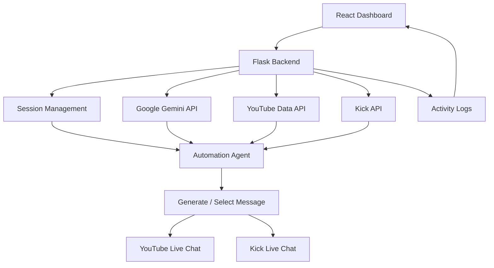

<div align="center">


<br/>

[](https://www.python.org/)
[](https://react.dev/)
[](https://flask.palletsprojects.com/)
[](https://vite.dev/)
[](https://ai.google.dev/)

<br/>

**A live chat automation dashboard for YouTube and Kick, powered by Google Gemini.**

</div>

---

## Overview

**StreamHelm** is a live chat automation application designed to simplify audience engagement on livestreaming platforms.

It provides a centralized dashboard to manage YouTube and Kick chat automation, generate AI-powered messages using Google Gemini, configure messaging intervals, and monitor activity in real time.

Whether you want AI-generated chat interactions or prefer sending predefined messages, StreamHelm gives you control over your live chat automation workflow.

## Features

### Multi-platform support
- Connect and manage YouTube and Kick accounts.
- Switch between platforms from a unified dashboard.
- Configure independent settings for each platform.

### AI-powered messaging
- Generate short, natural chat messages using Google Gemini.
- Use recent YouTube live chat messages as conversational context.
- Configure fallback messages for quiet chats or AI failures.
- Generate messages dynamically during each automation cycle.

### Manual messaging
- Switch between AI-generated and predefined messages.
- Configure your own custom message.
- Apply updated message settings without restarting the application.

### Automation controls
- Start and stop chat automation.
- Configure message intervals.
- Automatically introduce randomized delays between messages.
- Prevent multiple automation agents from running simultaneously for the same platform and session.

### Live dashboard
- Monitor authentication and automation status.
- View activity logs.
- Track sent messages through the application logs.
- Responsive interface for desktop and mobile devices.

---

## Tech Stack

| Layer | Technologies |
|---|---|
| Frontend | React.js, Vite, CSS |
| Backend | Python, Flask |
| AI Integration | Google Gemini API |
| YouTube Integration | YouTube Data API v3 |
| Kick Integration | Kick Public API, OAuth 2.1 with PKCE |
| Authentication | Google OAuth 2.0, Kick OAuth |
| Deployment | Render |

---

## Application Architecture



## Project Structure

```text
yt-chat-render/
│
├── app.py                  # Flask application and API routes
├── requirements.txt        # Python dependencies
│
├── frontend/
│   ├── index.html
│   ├── package.json
│   ├── vite.config.js
│   ├── src/
│   │   ├── App.jsx         # Main React dashboard
│   │   └── styles.css      # Application styling
│   └── dist/               # Generated production build
│
└── README.md
```

*Note: Update the frontend file tree if your current source files use a different arrangement.*

---

## Getting Started

### 1. Clone the repository

```bash
git clone https://github.com/Sankalp-03/yt-chat-render.git

cd yt-chat-render
```

### 2. Set up the Python environment

```bash
python -m venv venv
```

Activate the environment:

**Windows**

```bash
venv\Scripts\activate
```

**macOS / Linux**

```bash
source venv/bin/activate
```

Install dependencies:

```bash
pip install -r requirements.txt
```

### 3. Install frontend dependencies

```bash
cd frontend
npm install
```

### 4. Configure environment variables

Create the required environment variables in your local environment or deployment dashboard.

| Variable | Description |
|---|---|
| `FLASK_SECRET_KEY` | Secret key used for Flask sessions |
| `GOOGLE_CLIENT_CONFIG_JSON` | Google OAuth client configuration JSON |
| `GEMINI_API_KEY` | Google Gemini API key |
| `KICK_CLIENT_ID` | Kick developer application client ID |
| `KICK_CLIENT_SECRET` | Kick developer application client secret |
| `OAUTH_REDIRECT_URI` | YouTube OAuth callback URL |
| `KICK_REDIRECT_URI` | Kick OAuth callback URL |
| `PORT` | Server port; defaults to `5000` |

**Important:** Keep all credentials private. Never commit API keys, OAuth secrets, or `.env` files to GitHub.

### 5. Configure OAuth

**YouTube**
1. Create a project in Google Cloud Console.
2. Enable the YouTube Data API v3.
3. Configure the OAuth consent screen.
4. Create OAuth 2.0 credentials.
5. Add the following authorized redirect URI:

```text
http://localhost:5000/oauth2callback
```

**Kick**
1. Register an application through the Kick Developer Portal.
2. Obtain the client ID and client secret.
3. Configure the redirect URI:

```text
http://localhost:5000/kick/oauth2callback
```

For production, replace localhost with your deployed application's HTTPS domain.

### 6. Run the application

Build the React frontend:

```bash
cd frontend
npm run build
```

Start the Flask backend from the project root:

```bash
python app.py
```

Open:

```text
http://localhost:5000
```

For frontend development with Vite, use a separate terminal:

```bash
cd frontend
npm run dev
```

---

## Deployment

StreamHelm can be deployed on [Render](https://render.com/).

Configure the following:

**Build Command**

```bash
pip install -r requirements.txt && cd frontend && npm install && npm run build
```

**Start Command**

```bash
gunicorn app:app
```

Add all required environment variables in the Render dashboard.

Also update your Google and Kick OAuth applications with the production callback URLs:

```text
https://YOUR-APP.onrender.com/oauth2callback

https://YOUR-APP.onrender.com/kick/oauth2callback
```

---

## How It Works

1. Authenticate your YouTube or Kick account.
2. Select the platform you want to automate.
3. Enter the YouTube livestream URL or Kick channel URL.
4. Select a messaging mode:
   - **Gemini Chat:** Generate messages using AI.
   - **Manual Chat:** Send your configured message.
5. Configure the message interval and fallback messages.
6. Click **Start** to launch the automation agent.
7. Monitor activity and sent messages through the dashboard.
8. Click **Stop** whenever you want to end automation.

---

## Roadmap

The following are planned improvements, not currently implemented features:

- [ ] Stream-aware AI using live audio transcription.
- [ ] Visual stream analysis using sampled video frames.
- [ ] Contextual message generation based on stream events.
- [ ] Message preview and approval before sending.
- [ ] Improved message analytics and historical statistics.
- [ ] Persistent session and configuration storage.
- [ ] Enhanced automation controls and rate limiting.

---

## Important Notes

- You must authenticate the relevant platform before starting automation.
- YouTube and Kick permissions are subject to their respective API scopes and platform policies.
- Gemini-generated messages depend on the configured API key and service availability.
- The current implementation uses in-memory session state and activity logs; these are not persistent across server restarts.
- The activity log retains only the latest 100 entries per session and platform.
- Use automation responsibly and respect platform rules, chat rate limits, and community guidelines.

---

## Contributing

Contributions, suggestions, and bug reports are welcome!

1. Fork the repository.
2. Create a feature branch:

```bash
git checkout -b feature/your-feature-name
```

3. Commit your changes:

```bash
git commit -m "Add: your feature description"
```

4. Push your branch:

```bash
git push origin feature/your-feature-name
```

5. Open a Pull Request.

---

<div align="center">

### Built to make live chat smarter.

**StreamHelm**

[GitHub Repository](https://github.com/Sankalp-03/yt-chat-render)


</div>
